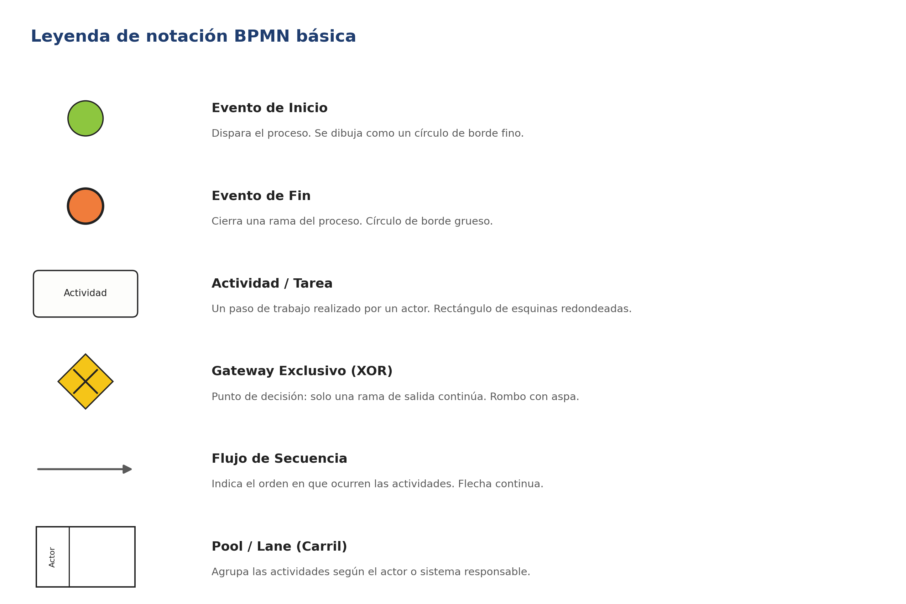
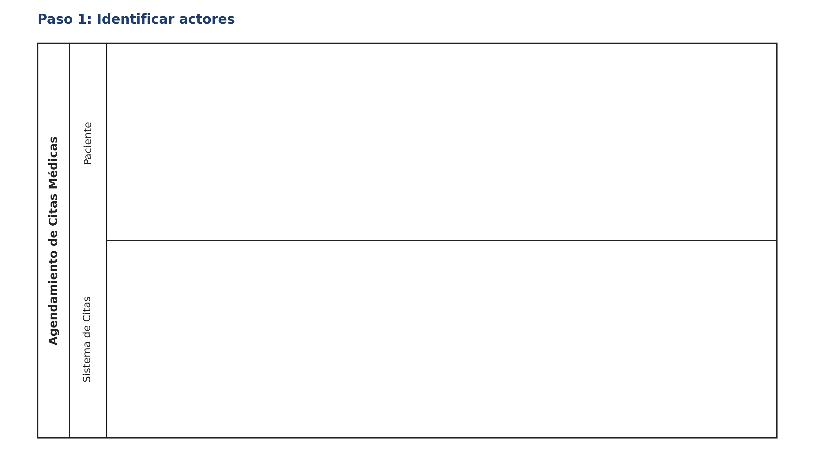
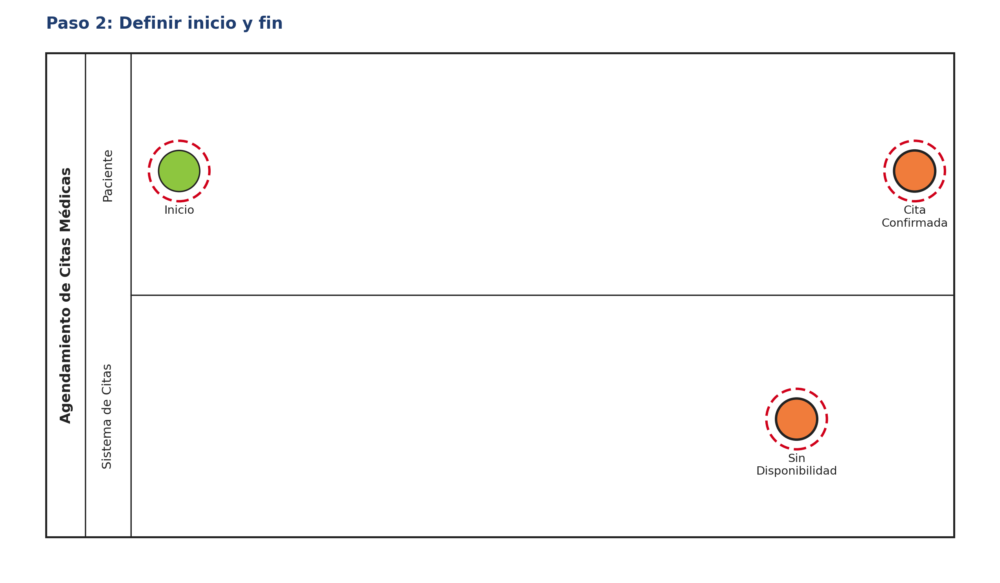
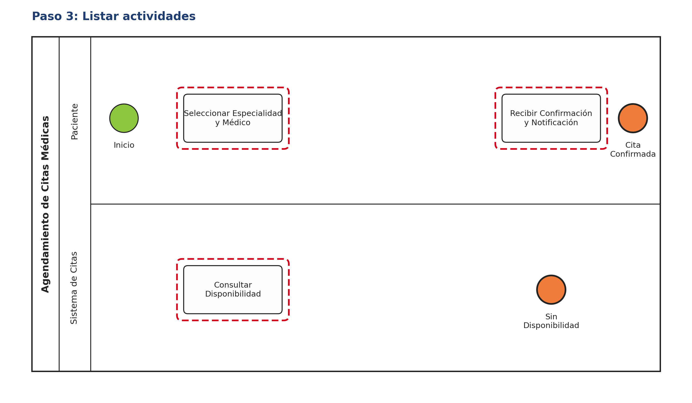
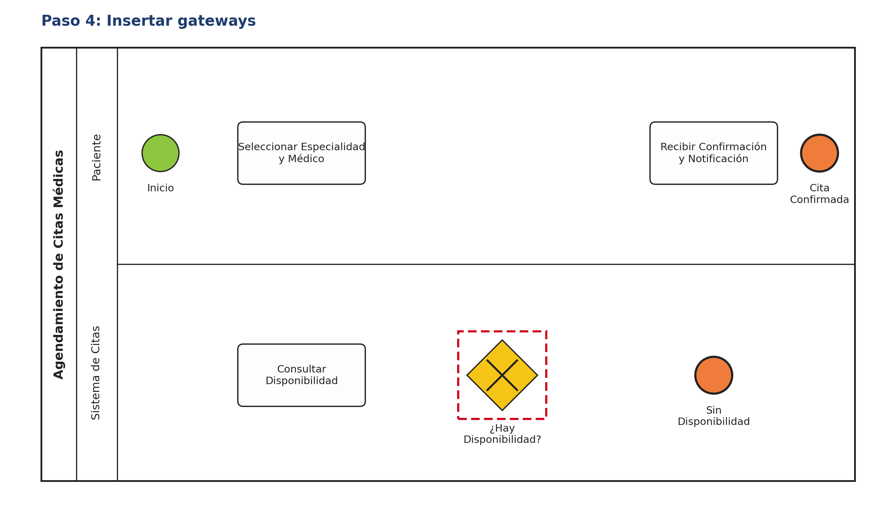
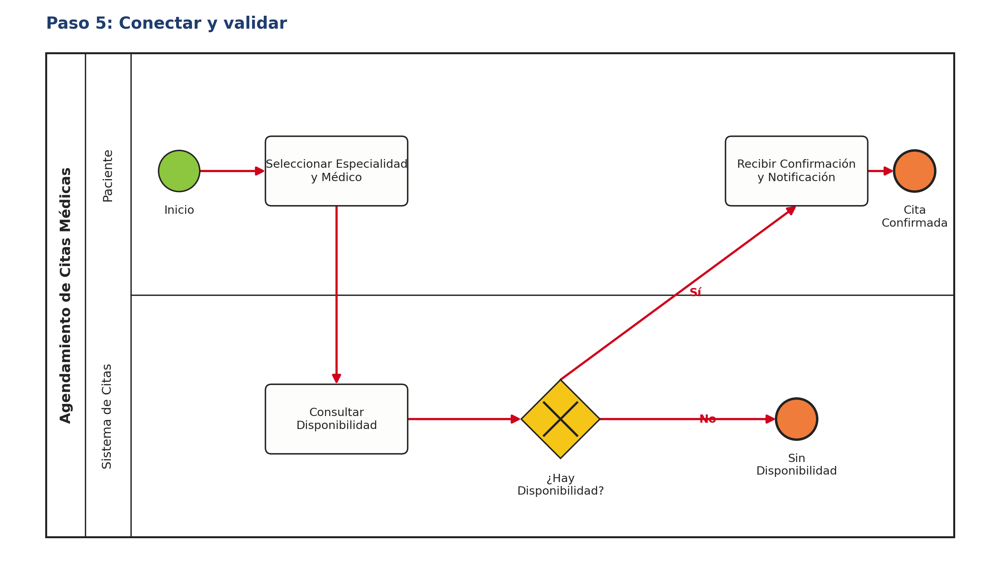
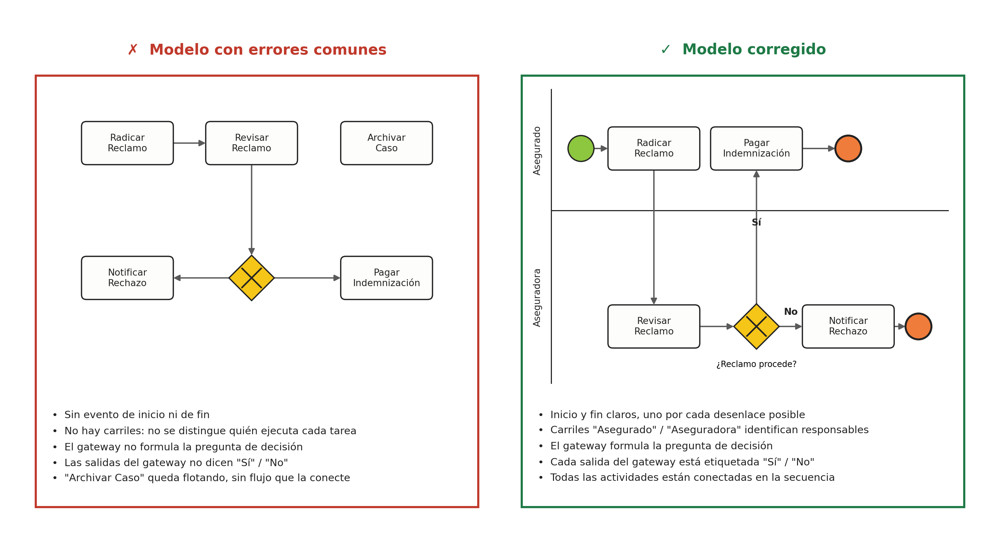
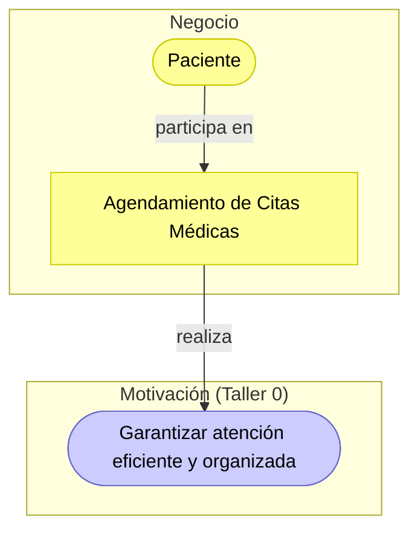

# Guía Paso a Paso: Cómo Modelar un Proceso en BPMN

Esta guía complementa el `README.md` del taller. Su objetivo es que, antes de modelar el proceso de **Agendamiento de Citas Médicas** en clase (Parte 1) o el proceso de su cliente real (Parte 2), el equipo tenga una referencia clara de la notación BPMN y de la metodología para construir el diagrama desde cero.

---

## 1. Leyenda de notación BPMN básica

Estos son los símbolos mínimos que debe usar todo diagrama del taller. Cualquier elemento adicional (eventos intermedios, tareas de usuario/servicio, gateways paralelos, etc.) es opcional y solo se recomienda si el proceso realmente lo necesita.

---

## 2. Metodología en 5 pasos

Siga siempre este orden. No empiece dibujando flechas: empiece identificando quién participa.

1. **Identificar actores** — liste las personas, roles o sistemas que participan en el proceso. Cada uno será un carril (*lane*) dentro del pool.
2. **Definir inicio y fin** — determine qué dispara el proceso (evento de inicio) y cuáles son sus posibles desenlaces (uno o varios eventos de fin).
3. **Listar actividades** — anote, en orden aproximado, las tareas que cada actor ejecuta. En esta etapa aún no se conectan con flechas.
4. **Insertar gateways** — identifique los puntos donde el flujo puede tomar más de un camino y formule la pregunta de decisión de cada uno.
5. **Conectar y validar** — una todos los elementos con flujos de secuencia, etiquete las salidas de cada gateway ("Sí"/"No" u otras condiciones) y revise que no queden actividades sueltas ni caminos sin evento de fin.

---

## 3. Ejemplo guiado: Agendamiento de Citas Médicas (Fundación Salud Viva)

Este es el mismo caso base descrito en el `README.md`. A continuación se construye el diagrama siguiendo, paso a paso, la metodología de la sección anterior. Úselo como referencia de método — no como plantilla para copiar, ya que en clase el docente puede ajustar el alcance del proceso.

El resultado final de este ejemplo está disponible como archivo editable en [`clase/ejemplo-agendamiento-citas.drawio`](ejemplo-agendamiento-citas.drawio) — ábralo en [draw.io](https://app.diagrams.net/) para ver el modelo completo con las dos lanes, el gateway y ambos eventos de fin. También puede explorar el mismo diagrama de forma interactiva y clickeable en [`clase/visualizacion-bpmn.html`](visualizacion-bpmn.html).

### Paso 1 — Identificar actores

Se determinan los dos participantes del proceso: el **Paciente**, que solicita la cita, y el **Sistema de Citas**, que valida disponibilidad y confirma. Cada uno se representa como un carril dentro del pool "Agendamiento de Citas Médicas".

### Paso 2 — Definir inicio y fin

El proceso inicia cuando el paciente decide agendar una cita. Se identifican también los dos desenlaces posibles: que la cita quede **confirmada** o que **no haya disponibilidad**. Definir esto antes que las actividades evita el error más común: diagramas sin evento de fin.

### Paso 3 — Listar actividades

Se anota, actor por actor, qué hace cada uno: el paciente selecciona especialidad y médico; el sistema consulta disponibilidad y, más adelante, notifica la confirmación. Nótese que en este paso las actividades aún no están conectadas — el objetivo es solo inventariarlas.

### Paso 4 — Insertar gateways

Se identifica el único punto de decisión del proceso: **¿hay disponibilidad?** Este gateway exclusivo (XOR) es el que determinará si el flujo continúa hacia la confirmación o hacia el cierre sin cita.

### Paso 5 — Conectar y validar

Se trazan los flujos de secuencia en el orden correcto y se etiquetan las dos salidas del gateway ("Sí" / "No"). Antes de dar por terminado el modelo, se valida que: todo camino termine en un evento de fin, el gateway tenga su pregunta y cada carril refleje solo las actividades de su actor.

---

## 4. Errores comunes a evitar

La siguiente comparación resume los errores que con más frecuencia bajan puntos en la rúbrica del taller ("Claridad del diagrama BPMN") frente a su corrección.

---

## 5. Checklist de autoevaluación antes de entregar

Antes de subir `modelo.drawio` (Parte 1) o `modelo-final.drawio` (Parte 2), verifique:

- [ ] Cada actor relevante tiene su propio carril (lane).
- [ ] Existe exactamente un evento de inicio.
- [ ] Todo camino del proceso termina en un evento de fin.
- [ ] Todas las actividades están conectadas por flujos de secuencia — no hay elementos flotantes.
- [ ] Cada gateway tiene una pregunta de decisión clara.
- [ ] Cada salida de un gateway está etiquetada (Sí/No, u otra condición explícita).
- [ ] Los nombres de las actividades son verbos de acción claros (ej. "Consultar Disponibilidad", no "Disponibilidad").
- [ ] El diagrama se puede leer de izquierda a derecha sin que las líneas se crucen innecesariamente.

---

## 6. Vista ArchiMate equivalente

El BPMN modela el **detalle** del proceso — carriles, gateways, flujos. La **capa de Negocio** de ArchiMate (ver la [Guía de Notación ArchiMate](https://github.com/CesarAVegaF312/AREM-ArchiMate/blob/main/guia_notacion_archimate.md)) lo resume en una sola caja: un **Business Process** que un **Business Actor** ejecuta y que **realiza** un objetivo de Motivación (Taller 0).

**No hay que elegir entre BPMN y ArchiMate**: el `Business Process` de ArchiMate es la caja resumen que conecta este taller con el resto de la arquitectura; el BPMN de `modelo.drawio` sigue siendo el lugar donde vive el detalle de carriles y decisiones.

---

## 7. Validación técnica del proceso (opcional)

La checklist de la sección 5 se revisa mirando el diagrama. Esta sección propone **comprobarla haciendo correr el proceso**: un simulador de tokens mueve una marca (el token) por cada flujo, igual que lo haría un motor de procesos. Si el token llega a un evento de fin por todos los caminos, el modelo está bien conectado; si se queda detenido en algún punto, hay un error que a simple vista no se nota. No es un ejercicio de programación: los archivos del caso base ya están listos en [`validacion-tecnica/`](validacion-tecnica/).

### 7.1 Qué se necesita

Una de estas dos opciones, ambas gratuitas:

- **En el navegador, sin instalar nada:** la [demostración de simulación de tokens de bpmn.io](https://bpmn-io.github.io/bpmn-js-token-simulation/modeler.html). Abra el archivo `.bpmn` (arrastrándolo sobre la página) y active la simulación con el interruptor "Token Simulation" o la tecla `T`.
- **En el computador:** [Camunda Modeler](https://camunda.com/download/modeler/) con el [plugin de simulación de tokens](https://github.com/camunda/camunda-modeler-token-simulation-plugin), que se instala copiándolo en la carpeta de plugins del programa.

### 7.2 Los archivos del caso base

| Archivo | Qué contiene |
|---|---|
| [`agendamiento-citas.bpmn`](validacion-tecnica/agendamiento-citas.bpmn) | El mismo proceso de [`ejemplo-agendamiento-citas.drawio`](ejemplo-agendamiento-citas.drawio), en formato BPMN 2.0: dos carriles, una compuerta exclusiva y dos eventos de fin. |
| [`agendamiento-citas-con-error.bpmn`](validacion-tecnica/agendamiento-citas-con-error.bpmn) | Una variante con un error hecho a propósito, para practicar. |

draw.io dibuja con la notación BPMN, pero no guarda el formato BPMN 2.0 que leen los simuladores y los motores de procesos. Por eso los archivos de esta carpeta están hechos en ese formato.

### 7.3 Simular el proceso correcto

1. Abra `agendamiento-citas.bpmn` y active la simulación.
2. Inicie un token en el evento "Paciente decide agendar cita".
3. Cuando el token llegue a la compuerta "¿Hay disponibilidad?", elija la salida **Sí**: el token debe terminar en "Cita Confirmada".
4. Repita eligiendo **No**: el token debe terminar en "Sin Disponibilidad".

Ambos caminos terminan en un evento de fin: se cumple el punto "todo camino del proceso termina en un evento de fin" de la checklist.

### 7.4 Encontrar el error

Abra `agendamiento-citas-con-error.bpmn` y repita la simulación. Por cualquiera de los dos caminos, el token se queda detenido en la compuerta "Error: unión paralela" y nunca llega a "Solicitud Atendida".

La causa: las dos salidas de una compuerta **exclusiva** (X), de la que sale un solo token, se vuelven a unir con una compuerta **paralela** (+), que espera un token por cada entrada. Como el segundo token nunca llega, el proceso se queda bloqueado. En un motor de procesos real, cada solicitud de cita quedaría abierta para siempre. La corrección es unir con una compuerta exclusiva, o terminar cada camino en su propio evento de fin, como en el modelo correcto.

Este error es difícil de ver en el diagrama, porque las dos compuertas se parecen, y la simulación lo hace evidente en segundos.

### 7.5 Aplicarlo al cliente real

1. Redibuje el proceso del cliente (`entrega/modelo-final.drawio`) en el simulador de bpmn.io o en Camunda Modeler. Para un proceso del tamaño del taller toma unos minutos.
2. Guárdelo como `entrega/validacion-tecnica/modelo-final.bpmn`.
3. Simule **todas** las salidas de **todas** las compuertas.
4. En `entrega/informe.md`, anote qué caminos probó y cualquier error que la simulación encontró (camino sin fin, token detenido, actividad a la que nunca llega un token), junto con la corrección que hizo en el diagrama.

---

## 8. Análisis de caso real y panorama tecnológico (opcional)

### 8.1 Caso: Knight Capital pierde más de 460 millones de dólares en 45 minutos (Estados Unidos, 2012)

**Qué pasó.** Knight Capital era una de las firmas de corretaje bursátil más grandes de Estados Unidos. Para una nueva función, un técnico instaló manualmente el código nuevo en los ocho servidores de su sistema de envío de órdenes, pero uno de ellos quedó sin actualizar y conservó un código antiguo en desuso. Ninguna otra persona revisó la instalación. El 1 de agosto de 2012, al abrir el mercado, ese servidor empezó a enviar órdenes sin control: en 45 minutos el sistema envió más de 4 millones de órdenes al intentar ejecutar solo 212 órdenes de clientes, y la firma perdió más de 460 millones de dólares. Antes de la apertura, el sistema había generado 97 correos automáticos que mencionaban el error, pero no se trataron como alertas. En octubre de 2013, la Comisión de Bolsa y Valores de Estados Unidos (SEC) le impuso una multa de 12 millones de dólares.

**Qué falló, en el lenguaje de este taller.**

| Elemento del proceso de instalación | Qué falló |
|---|---|
| Actividad "Instalar en cada servidor" | Se repetía a mano ocho veces, sin una lista de verificación. |
| Compuerta que faltaba | No había una decisión "¿Todos los servidores tienen la versión nueva?" antes de seguir. El proceso continuaba igual si un servidor fallaba. |
| Carril que faltaba | No había un segundo actor (un revisor) en el proceso. |
| Camino de excepción | Los 97 correos de error no llegaban a una actividad con un responsable: era un camino que no terminaba en ninguna acción. |

**Preguntas para el análisis.**

1. Modele en BPMN el proceso de instalación de Knight tal como se describe, y luego la versión corregida, con la compuerta de verificación y el carril del revisor.
2. Simule los dos modelos. ¿Por qué camino pasa el token cuando un servidor queda sin actualizar?
3. ¿Qué proceso del cliente real se hace a mano, de forma repetida, sin que nadie verifique el resultado?

**Fuentes.** [SEC, comunicado de prensa 2013-222 (16 de octubre de 2013)](https://www.sec.gov/news/press-release/2013-222), que resume la orden administrativa Release No. 34-70694. Las cifras de pérdida varían según la fuente (por ejemplo, 440 millones antes de impuestos en algunos reportes de la época); aquí se usa la de la SEC.

### 8.2 Panorama tecnológico: del diagrama a la operación

El modelo BPMN es la base de varias familias de tecnología. Cada una responde a una pregunta distinta del cliente.

| Familia | Ejemplos | Para qué sirve | Conviene cuando |
|---|---|---|---|
| Modelado BPMN | draw.io, bpmn.io, Camunda Modeler, Bizagi Modeler | Documentar y comunicar el proceso | Siempre: es el punto de partida |
| Motores y plataformas de procesos (BPMS) | Camunda, Flowable, Bizagi | Ejecutar el modelo BPMN: el motor asigna tareas a personas y sistemas y controla que se cumpla el flujo | El proceso tiene muchas instancias, varios actores y reglas que deben cumplirse siempre (aprobaciones, trámites) |
| Plataformas de bajo código | Microsoft Power Automate, Appian | Automatizar flujos sin programar, conectados a correo, formularios y aplicaciones de oficina | Procesos internos sencillos en una organización que ya usa esas herramientas |
| Automatización robótica de procesos (RPA) | UiPath, Power Automate Desktop | Un programa imita los clics de una persona en sistemas que no tienen otra forma de integrarse | Tareas repetitivas sobre sistemas antiguos; no corrige un proceso mal diseñado, solo lo hace más rápido |
| Minería de procesos | Celonis, PM4Py, ProM | Reconstruir el proceso **real** a partir de los registros (logs) de los sistemas y compararlo con el modelado | El cliente tiene sistemas que registran cada paso y se sospecha que el proceso real no es el documentado |

Bizagi es una empresa de origen colombiano que hoy tiene operación internacional. Su herramienta de modelado, Bizagi Modeler, es gratuita.

La pregunta de arquitectura no es "¿qué herramienta es mejor?", sino "¿qué problema del proceso del cliente se quiere resolver?": documentarlo, controlarlo, automatizarlo o descubrir cómo funciona en realidad. Esa decisión se retoma en el TO-BE del Taller 7.

### 8.3 Aplicarlo al cliente real

1. Busque un caso público y documentado de una falla de proceso en el sector del cliente: un trámite que se cayó, un error repetido, una sanción por incumplir un procedimiento.
2. Analícelo con la [plantilla de análisis de caso](../plantillas/plantilla_analisis_caso.md) y guárdelo en `entrega/analisis-caso.md`.
3. En la sección 5 de la plantilla, compare dos tecnologías del panorama anterior para el proceso que modeló del cliente.

---

_Esta guía hace parte del Taller 1 de Modelado de Procesos con BPMN — curso Arquitectura Empresarial, Universidad de La Sabana._
